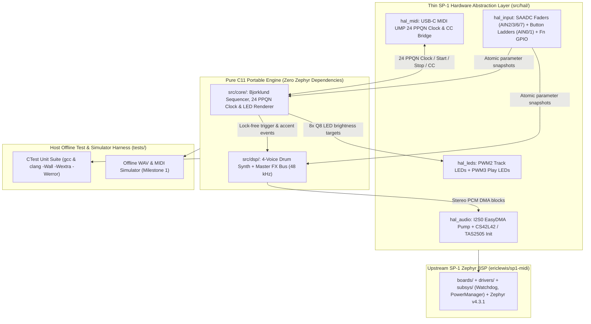
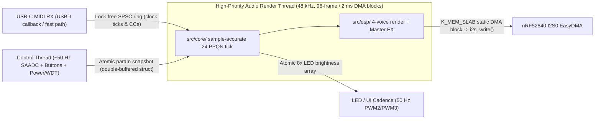

# SP-1 Euclidean Drum Machine — Firmware Architecture & Roadmap

## 1. System Overview

This firmware transforms the Teenage Engineering Stem Player SP-1 (Nordic nRF52840, 64 MHz Cortex-M4F with FPU, 256 KB SRAM, 1 MB Flash) into a standalone 4-track Euclidean drum machine featuring:

- **Pure C11 Sequencer & Clock Core (`src/core/`):** 4-track Bjorklund Euclidean rhythm generator, pattern/accent state, PWM LED state renderer, and jitter-tolerant 24 PPQN USB-C MIDI clock master/follower sync.
- **Pure C11 Drum DSP & Performance FX Engine (`src/dsp/`):** 4 synthesized drum voices (Kick, Snare, Hi-Hat, FM/Wavefold Perc) + stereo master FX bus (DJ TPT State-Variable Filter, soft-clip drive, tempo-synced beat-repeat/stutter delay) running at 48 kHz.
- **Thin SP-1 Zephyr HAL (`src/hal/`):** Bridges the portable C11 engine to the SP-1's nRF52840 peripherals (I2S0 48 kHz EasyDMA, CS42L42 headphone codec, TAS2505 speaker amp, SAADC analog faders and button ladders, PWM2/PWM3 LEDs, USB-C MIDI 2.0/1.0 UMP).
- **Host Simulator & Unit Tests (`tests/`):** Compiles `src/core/` and `src/dsp/` natively under x86_64 `gcc` and `clang` (`-std=c11 -Wall -Wextra -Werror`) with zero Zephyr dependencies, enabling offline WAV rendering and deterministic MIDI/clock regression testing without hardware attached.

---

## 2. Layered Architecture & Upstream Isolation

All new drum machine code is strictly isolated under `src/` (`src/core/`, `src/dsp/`, `src/hal/`). Upstream `ericlewis/sp1-midi` directories (`boards/`, `drivers/`, `subsys/`, `app/`) remain untouched except for minimal entry-point wiring introduced in Milestone 1+, preserving clean upstream cherry-picks and future rebasing onto `Worldwave/Wakes`.

### Module Boundaries

| Layer | Directory | Language / Standard | Allowed Includes | Tested On |
|---|---|---|---|---|
| **Core Sequencer & Clock** | `src/core/` | C11 (`-Wall -Wextra -Werror`) | C11 std headers (`stdint.h`, `stdbool.h`, `stddef.h`, `string.h`, `math.h`) only | Host (`gcc`, `clang`) + ARM (`arm-zephyr-eabi-gcc`) |
| **Audio DSP & FX** | `src/dsp/` | C11 (`-Wall -Wextra -Werror`) | C11 std headers + `src/core/` event types only | Host (`gcc`, `clang`) + ARM (`arm-zephyr-eabi-gcc`) |
| **SP-1 HAL** | `src/hal/` | C11 / C++17 (no RTTI/exceptions) | Zephyr APIs, `drivers/audio/`, `subsys/`, `src/core/`, `src/dsp/` | ARM (`stem_player` Zephyr target) |
| **Upstream BSP** | `boards/`, `drivers/`, `subsys/`, `app/` | Upstream C / C++17 | Untouched upstream `ericlewis/sp1-midi` | ARM (`stem_player` Zephyr target) |

---

## 3. Verified Hardware Interface Summary (nRF52840 SP-1)

Grounded directly in `boards/teenageengineering/stem_player/stem_player.dts` and `stem_player-pinctrl.dtsi`:

- **4x Analog Faders (12-bit SAADC):** `Fader 1 = AIN3 (P0.05)`, `Fader 2 = AIN6 (P0.30)`, `Fader 3 = AIN2 (P0.04)`, `Fader 4 = AIN7 (P0.31)`.
- **Buttons:** Track 1–4 + Play resistor ladder on `AIN0 (P0.02)`; RWD / Vol- / FWD / Vol+ resistor ladder on `AIN1 (P0.03)`; Function (`••`) button on GPIO `P0.27` (active-low, 3 s hold triggers `sys_poweroff()`); common rail `P1.10`.
- **8x PWM LEDs (1024 µs period):** `PWM2` Track LEDs (`P0.29`, `P0.26`, `P1.15`, `P1.14`); `PWM3` Play LEDs (`P0.01`, `P1.12`, `P0.00`, `P1.13`).
- **Audio Path:** External 3.072 MHz oscillator (`P0.13` hog) → `I2C0` (`P1.07` SDA / `P1.11` SCL) CS42L42 headphone codec (`0x48`, reset `P0.15`) + TAS2505 speaker amp (`0x18`, reset `P0.09`) → `I2S0` master (`BCLK P0.12`, `LRCK P0.11`, `SDOUT P1.09`) @ 48 kHz.
- **USB-C Composite Stack:** `zephyr_udc0` Full-Speed USB (`usbd_midi2` UMP MIDI + `cdc_acm_uart0` debug shell).
- **Bootloader & Recovery:** `T1+T4` held on USB-C plug-in enters the protected Teenage Engineering bootloader (`0x00000`–`0x1FFFF`) for Web Serial `.bin` flashing via `solderless.engineering`. App images MUST remain linked at `0x20000` (`CONFIG_USE_DT_CODE_PARTITION=y`).

---

## 4. Real-Time Concurrency & Hard-RT Contract

- **Zero heap allocation after boot:** No `malloc`/`free`/`k_malloc`/`new` anywhere in `src/core/`, `src/dsp/`, or post-init `src/hal/`.
- **Zero blocking calls in RT paths:** No mutexes, `k_sleep`, `printk`/`LOG_*`, eMMC I/O, or runtime divisions inside the audio render loop or 24 PPQN timer callbacks.
- **CPU Cycle Budget (nRF52840 @ 64 MHz):** `1,333` cycles/sample ceiling at 48 kHz (`128,000` cycles per 96-frame / 2 ms block). Target DSP utilization `<= 55%` (`~690` cycles/sample) using `uint32_t` phase accumulators, Flash-resident `const float` LUTs, single-precision FPU (`f` literals), and Cytomic TPT SVFs.

---

## 5. Memory Budget (Baseline vs. Planned Static Allocations)

Measured on stock `ericlewis/sp1-midi` built with Zephyr `v4.3.1` + Zephyr SDK `0.17.4` (`-DBOARD=stem_player -DSNIPPET=cdc-acm-console`):

| Component | FLASH (`slot0_partition`: 892 KB) | SRAM (`sram0`: 256 KB) | Notes |
|---|---:|---:|---|
| **Measured Baseline (`sp1-midi`)** | **190,060 B (20.81%)** | **48,732 B (18.59%)** | `text=186,348`, `data=3,704`, `bss=45,030` |
| `src/core/` (Sequencer, 24 PPQN Clock, LEDs) | ~8 KB | ~2 KB | Static 4x32-step Euclidean masks, pattern bank, clock state |
| `src/dsp/` (4 Voices + Flash LUTs + SVFs) | ~20 KB | ~4 KB | Sine/wavefold LUTs in `.rodata` Flash; voice structs in BSS |
| `src/dsp/` Master Stutter/Delay Buffer | 0 B | ~32–64 KB | Static power-of-2 `int16_t` circular buffer (`16384`–`32768` samples) |
| `src/hal/` (I2S0 `K_MEM_SLAB`, Audio Thread Stack, SPSC Queues) | ~12 KB | ~12 KB | 96-frame stereo DMA blocks (`TX_QUEUE + 4` slabs) + 4 KB audio stack |
| **Projected Total Firmware** | **~230 KB (~25.2%)** | **~99–131 KB (~38–51%)** | **> 660 KB Flash & > 125 KB SRAM headroom remaining** |

---

## 6. Milestone 1–4 Roadmap Checklist

### Milestone 0 — Workspace Harness, Rules, Skills, Knowledge Graph & Reference Resources *(Complete)*
- [x] Configure `origin` (`davidlwarner/sp1-drum`) and `upstream` (`ericlewis/sp1-midi`) git remotes.
- [x] Clone `SP-1-dev`, `sp1-tape-looper`, and `Wakes` into gitignored `reference/`.
- [x] Install user-space Zephyr `v4.3.1` + SDK `0.17.4` and verify clean stock `sp1-midi` baseline build + FLASH/RAM footprint.
- [x] Build deterministic AST knowledge graph across repo + `reference/` (`graphify-out/`).
- [x] Establish `.gemini/rules/embedded-audio.md`, `.gemini/rules/graphify.md`, `.gemini/skills/sp1-hardware-map/SKILL.md`, and `.gemini/skills/embedded-dsp-c/SKILL.md`.
- [x] Scaffold zero-dependency host C11 test harness (`tests/` + `ctest`) verified on `gcc` and `clang` with `-Wall -Wextra -Werror`.

### Milestone 1 — HAL Decoupling (`src/hal/`) & Host WAV/MIDI Offline Simulator
- [ ] Define clean C11 HAL interface headers (`src/hal/hal_audio.h`, `hal_controls.h`, `hal_leds.h`, `hal_midi.h`, `hal_time.h`) decoupling platform peripherals from `src/core/` and `src/dsp/`.
- [ ] Implement SP-1 Zephyr HAL stubs/adapters wrapping upstream `drivers/audio/` (CS42L42/TAS2505), SAADC faders/buttons, PWM2/PWM3 LEDs, and USB-C MIDI UMP without mutating upstream BSP internals.
- [ ] Build a host offline WAV + MIDI event simulator (`tests/sim/`) capable of driving `src/core/` + `src/dsp/` with synthetic fader/button/24 PPQN clock scripts and exporting 48 kHz 16-bit stereo `.wav` files + MIDI logs for rapid desktop iteration.
- [ ] Add automated host CTest coverage for HAL ring-buffer/snapshot contracts and simulator smoke output.

### Milestone 2 — Pure C11 Euclidean Sequencer, PWM LED Renderer & 24 PPQN MIDI Sync (`src/core/`)
- [ ] Implement deterministic integer Bjorklund Euclidean rhythm generator (`E(k, n)` with rotation offset, 1–32 steps, static bitmasks) for 4 independent tracks.
- [ ] Implement sample-accurate internal tempo generator (40–240 BPM, swing) and external USB-C MIDI 24 PPQN clock follower (`0xF8` Clock, `0xFA` Start, `0xFB` Continue, `0xFC` Stop) with PLL/smoothing and automatic master/follower failover.
- [ ] Implement pure C11 PWM LED state renderer mapping step playhead, track trigger flashes, Euclidean density/rotation feedback, mute states, and clock sync indicator onto the 8 SP-1 LEDs (`4 Track + 4 Play`).
- [ ] Add comprehensive host CTest unit tests verifying Bjorklund Euclidean patterns (canonical rhythms like `E(3,8)`, `E(5,8)`, `E(5,16)`), rotation wrapping, 24 PPQN step timing accuracy, and LED brightness frames.

### Milestone 3 — Pure C11 4-Voice Drum DSP Synth, Master FX Bus (`src/dsp/`) & I2S0 48 kHz Audio Integration
- [ ] Implement 4 statically allocated C11 drum voices at 48 kHz:
  - **Track 1 (Kick):** Pitch-envelope sine oscillator (Flash LUT) + transient click + soft-clip drive.
  - **Track 2 (Snare):** Tuned body sine + `xorshift32` noise through TPT SVF + snappy amp envelope.
  - **Track 3 (Hi-Hat):** Metallic multi-oscillator XOR/square cluster + noise + HP TPT SVF + open/closed choke decay.
  - **Track 4 (Perc):** 2-op phase-modulation FM + wavefolder synth + resonant TPT SVF.
- [ ] Implement stereo Master Performance FX bus: DJ LP/HP TPT SVF, warm bus drive/limiter, and tempo-synced beat-repeat/stutter circular delay buffer.
- [ ] Wire `src/hal/hal_audio` to SP-1 `CS42L42` + `TAS2505` init sequence (oscillator `P0.13` → I2C0 codec config → I2S0 EasyDMA 96-frame / 2 ms stereo blocks) and integrate into the Zephyr build with zero warnings under `-Wall -Wextra -Werror`.
- [ ] Verify DSP stability (NaN/Inf/denormal/clipping checks), impulse/WAV renders on host, and full ARM firmware build & memory footprint.

### Milestone 4 — Hardware-in-the-Loop (HIL) Flashing, ISR Cycle Profiling, Stress Testing & Gesture Manual
- [ ] Validate all SP-1 "Big Five" safety gates (`CONFIG_USE_DT_CODE_PARTITION=y`, `slot0_partition >= 0x20000`, watchdog feeds, fatal reboot handler, `SYSTEM_OFF` codec/LED teardown, `T1+T4` recovery).
- [ ] Flash `build/zephyr/zephyr.bin` to physical SP-1 hardware via `solderless.engineering` and verify audio output (headphones + internal speaker), fader calibration, button chords, PWM LED orientation, and USB-C MIDI 24 PPQN sync against a DAW/hardware sequencer.
- [ ] Profile worst-case audio block render cycles via DWT `CYCCNT` / `k_cycle_get_32()` under simultaneous 4-voice hits + heavy FX + dense USB-MIDI CC/clock traffic (target `< 65%` CPU peak, zero I2S underruns).
- [ ] Write the user-facing SP-1 Drum Machine Performance & Gesture Manual (`docs/MANUAL.md`).
